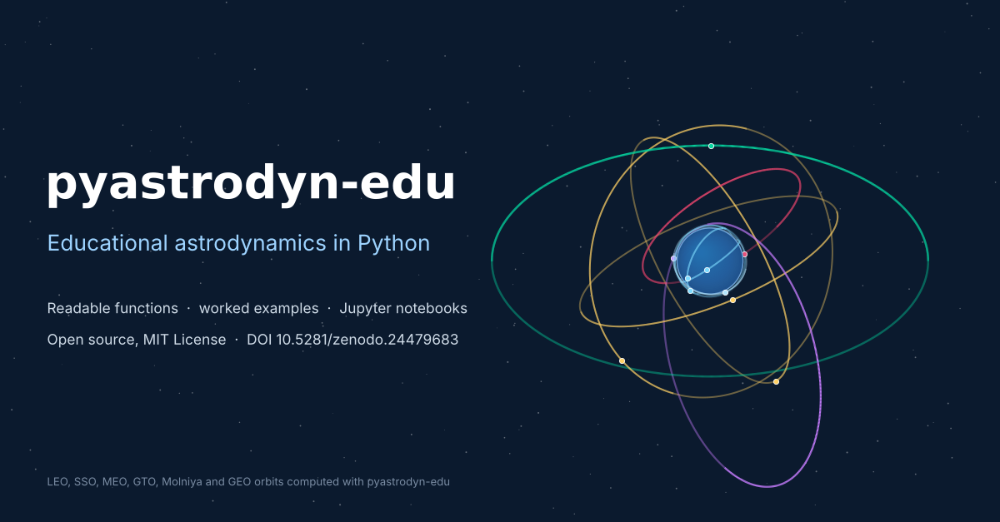

# PyAstroDyn-edu

[](https://doi.org/10.5281/zenodo.24479683)



Educational astrodynamics in Python.

PyAstroDyn-edu is the companion library of the graduate course in orbital
mechanics of the Technical University of Munich (TUM), Chair of Astrodynamics.

> **Provided as is.** The software is given as is, without warranty of any
> kind (see the file `LICENSE`). Installation and use are not supported: the
> author does not provide help with installing or using it.

## Where to find it

| What | Where |
|---|---|
| Everything: code, example problems, notebooks, getting-started guide, tests | GitHub: <https://github.com/pyastrodyn/pyastrodyn-edu> |
| The library alone, to install with `pip install pyastrodyn-edu` | PyPI: <https://pypi.org/project/pyastrodyn-edu/> |
| Archived versions and DOI, to cite it | Zenodo: <https://doi.org/10.5281/zenodo.24479683> |

To learn with the example problems and the notebooks, download the whole
project from GitHub (see `docs/getting_started.md`): the package on PyPI
contains only the library.

## Purpose and scope

1. **Learning.** A small, readable Python library that accompanies the TUM
   graduate course in orbital mechanics (WS 2026/27).
2. **Useful computation.** Results are trustworthy within stated models and
   stated tolerances, so the library can be used for mission-analysis-level
   work, not only for classroom examples.

What this means in practice:

- **Written to be read.** Plain functions on NumPy arrays. Every function
  states what it computes, in which basis and units, which books it draws on
  and in which lecture it is taught. The code is commented step by step, and
  the hardest algorithms also exist in a single-state version meant for a
  first reading (section 6).
- **Stated models.** This version covers Lectures 1 to 6. Keplerian motion
  is that of the ideal two-body problem: no perturbations there (no J2, no
  drag, no third body).
  The maneuvers are impulsive burns in that same ideal problem.
- **Stated tolerances.** Closed-form functions are accurate to floating-point
  rounding. The iterative and numerical ones (the solver of Kepler's equation
  and the integrators) state their tolerance and their measured accuracy in
  their documentation.
- **Out of scope:** attitude dynamics, high-fidelity force models and
  operational orbit determination. For those, use the tools of section 5.

Function names may still change before version 0.1.0.

## How to learn with this library

The library is learned one **example problem** at a time: first its
notebook, to experiment with the data; then its script, to read the solution
as ordinary Python; then the functions of the library that the script calls.
The sequence is described click by click in **Step 11 of
`docs/getting_started.md`**.

The example problems are in the folders `examples/lecture01`,
`examples/lecture02` and so on, one folder per lecture; `examples/README.md`
lists them.
Their statements and results are also in `docs/problems.md`.

## 1. Installation

**New to Python?** Follow `docs/getting_started.md` (also as a PDF,
`docs/getting_started.pdf`): step-by-step instructions for Windows, macOS and
Linux, from installing Python and Visual Studio Code to running a first
example and a first notebook.

In short: Python 3.11 or newer is required. To install only the library,
from PyPI:

```
pip install pyastrodyn-edu
```

To work with the whole project downloaded from GitHub, from the folder that
contains this file:

```
pip install -e .
```

The library itself needs only NumPy and SciPy. Optional extras:

```
pip install -e ".[plot]"    # Matplotlib, for the plotting functions
pip install -e ".[dev]"     # everything needed to run the tests and the notebooks
```

To run the tests: `python -m pytest`.

## 2. A short example

```python
import numpy as np
import pyastrodyn_edu as ad

mu = ad.MU_EARTH                      # km^3/s^2

# Classical elements -> position and velocity in the inertial basis N
a, e = 9500.0, 0.15                   # km, -
i, raan, argp, f = np.radians([52.0, 40.0, 110.0, 75.0])
r_N, v_N = ad.coe2rv(a, e, i, raan, argp, f, mu)

# ... and back
a, e, i, raan, argp, f = ad.rv2coe(r_N, v_N, mu)

# Period, and the state a quarter of a period later (Kepler's equation)
T = ad.period(a, mu)
r_N, v_N = ad.propagate_kepler_rv(r_N, v_N, T / 4.0, mu)
```

```python
# A prograde burn of 0.1 km/s, given in Hill components (radial, transverse, normal)
v_N = ad.apply_impulse(r_N, v_N, [0.0, 0.1, 0.0])
```

Every function has a documentation string; in Jupyter, type `ad.coe2rv?`.
A slightly longer first example is in `examples/first_steps.py`.

## 3. Conventions

**Frame, basis, Cartesian coordinate system: three different things.** The
library and the course keep them apart.

| Term | What it is | What it is used for | Examples |
|---|---|---|---|
| Frame (reference frame) | A rigid reference with respect to which motion is measured | Velocities, time derivatives and angular velocities are always "with respect to" a frame | The inertial frame; the frame that rotates with the Earth |
| Basis (in the slides of the course: vector base) | Three mutually orthogonal unit vectors, fixed in a frame | Writing a vector as three components | N, P, H, E in the table below |
| Cartesian coordinate system | An origin together with a basis | Locating points, not only directions | ECI: the centre of the Earth with the basis N. ECEF: the centre of the Earth with the basis E |

- A basis is fixed *in* a frame; a frame has infinitely many bases fixed in
  it. The same vector can be written in any basis, whatever the frame with
  respect to which it was measured: the inertial velocity can have its
  components in the Hill basis.
- "Basis" (the word of this library) and "vector base" (the word of the
  slides) mean the same thing.
- The suffix of a name in this library is a basis: `r_N`, `v_H`, `C_HN`. The
  origin is stated in words; unless said otherwise, positions are measured
  from the centre of the central body.
- Many books, papers and programs do not make this distinction: "frame",
  "basis" and "coordinate system" are often used as synonyms, or one word
  covers all three ("the ECI frame", "the Hill frame", "the LVLH frame").
  When reading them, ask each time which of the three is meant.

**Vectors carry their basis in their name.** `r_N` is a position given by its
components in the basis N. A name without a suffix is a scalar.

| Letter | Basis | Axes |
|---|---|---|
| N | Inertial (Earth-centred inertial when the Earth is the central body) | |
| P | Perifocal | 1 to the periapsis, 3 along the angular momentum |
| H | Hill | 1 radial, 2 transverse, 3 along the angular momentum |
| E | Earth-fixed | rotates with the Earth about axis 3 |

**Rotation matrices read "to, from".** `C_HN` takes components in N and
returns components in H: `v_H = C_HN @ v_N`. The vector does not move; only
its description changes (the passive convention), so the library has a
function `change_basis` and none called "rotate". The inverse is the
transpose, `C_NH`, returned by `invert_dcm`. The functions
that build these matrices are named after the result: `dcm_HN`, `dcm_NP`,
`dcm_EN`.

**Orbital elements**, always in this order: `a, e, i, raan, argp, f`.

| Quantity | Here | Curtis | Vallado | Alfriend et al. | GMAT | Basilisk |
|---|---|---|---|---|---|---|
| Semi-major axis | `a` | a | a | a | `SMA` | `a` |
| Eccentricity | `e` | e | e | e | `ECC` | `e` |
| Inclination | `i` | i | i | i | `INC` | `i` |
| Right ascension of the ascending node | `raan` | Ω | Ω | Ω | `RAAN` | `Omega` |
| Argument of periapsis | `argp` | ω | ω | ω | `AOP` | `omega` |
| True anomaly | `f` | θ | ν | f | `TA` | `f` |
| Argument of latitude (`argp + f`) | `arglat` | u | u | θ | | |

Other symbols: `E` eccentric anomaly, `M` mean anomaly, `h` specific angular
momentum, `p` semi-latus rectum, `mu` gravitational parameter, `F`, `G`,
`Fdot`, `Gdot` Lagrange coefficients.

Singular cases are handled with stated conventions (see `rv2coe`): for a
circular orbit `argp = 0` and `f` is measured from the ascending node; for an
equatorial orbit `raan = 0`.

**One state or many in one call.** A vector has shape `(3,)` for one state or
`(n, 3)` for n states, one row per state; a scalar argument is a number or an
array of shape `(n,)`. The result has the matching shape. One value can be
combined with many, for example one orbit with an array of true anomalies.
To change the basis of many vectors at once use `ad.change_basis(C_BA, v_A)`,
and `ad.invert_dcm(C_BA)` for the matrix in the opposite direction.

**Functions are pure.** They have no hidden state and never modify their
arguments. The gravitational parameter `mu` is always passed explicitly.

## 4. Units

- The library has **no built-in unit**. Every function is correct in any
  consistent set of length unit, time unit and `mu`.
- **Angles are in radians** everywhere.
- The constants in `ad.constants` are in **km, s, kg** (WGS 84 values for the
  Earth): `MU_EARTH`, `R_EARTH`, `OMEGA_EARTH`, `SIDEREAL_DAY`, `G0`.
- **Scaling.** `UnitSystem` converts between unit systems. Canonical units, in
  which `mu = 1`:

```python
canonical = ad.UnitSystem.canonical(ad.MU_EARTH, 6778.0)   # length unit: 6778 km
r = canonical.nondim(r_N, "length")
v = canonical.nondim(v_N, "speed")
elements = ad.rv2coe(r, v, 1.0)                            # mu = 1
t_seconds = canonical.dim(2 * np.pi, "time")               # one period of the reference orbit
```

Convert once at the start of a script and once at the end; do not mix systems
in between.

## 5. External tools

PyAstroDyn-edu does not depend on any of the tools below and does not include
them: you install them yourself if you want them. The plan is one small adapter
per tool, which converts units, angle units, ordering and names. **No adapter
exists yet in this version**; the table says what is planned.

| Tool | What it is | Its units | Adapter |
|---|---|---|---|
| [GMAT](https://sourceforge.net/projects/gmat/) | NASA's General Mission Analysis Tool | km, km/s; angles in degrees | Planned first: write script fragments, read report files |
| [SPICE](https://naif.jpl.nasa.gov/naif/), through [SpiceyPy](https://spiceypy.readthedocs.io/) | NASA/JPL toolkit for ephemerides and reference frames | km, km/s; time in seconds past J2000 (TDB) | Planned |
| [Basilisk](https://avslab.github.io/basilisk/) | Astrodynamics simulation framework, University of Colorado Boulder | m, m/s | Planned |
| [NASA 42](https://software.nasa.gov/software/GSC-16720-1) | Spacecraft attitude and orbit simulation, NASA Goddard | to be confirmed | Planned |
| [Astropy](https://www.astropy.org/) | Astronomy library; time scales and Earth orientation | quantities with units | Optional; not needed by the library |

Naming is already compatible: the rotation matrix written `C_HN` here is
`dcm_HN` in Basilisk, and both read "to H, from N". The table in section 3
maps the element names.

For each function, `docs/crossref.md` lists the books, the lecture and, once
checked, the equivalent in each tool.

## 6. What is covered

| Lecture | Topic | Module |
|---|---|---|
| 1 | Equation of motion; angular momentum, eccentricity vector, energy; numerical integration (adaptive, and a written-out Runge-Kutta 4) | `twobody` |
| 2 | Orbit equation, conic sections, vis-viva equation, classification of the orbits | `conics` |
| 3 | Elliptical and circular orbits, period, geosynchronous orbit; scaling | `conics`, `anomalies`, `units` |
| 4 | Mean anomaly, Kepler's equation, position as a function of time | `anomalies`, `kepler` |
| 5 | Rotation matrices, state and orbital elements, equinoctial elements, Lagrange coefficients | `rotations`, `elements`, `lagrange` |
| 6 | Rocket equation, impulsive burns, single-impulse maneuvers, tangential impulses at the apses, Oberth effect, burn of finite duration | `maneuvers` |

Also: `constants`, `plotting`, `validation`, and `single_state`.


`docs/functions.md` is the function guide: a map of the modules, and for
every function what it computes, its inputs and outputs, its references and
its limits of validity. It is generated from the documentation strings in
the code by one command, `python tools/make_docs.py`, so it always describes
the code as it is; `docs/problems.md` and `docs/crossref.md` are generated
by the same command.

**Reading the code.** Start with `pyastrodyn_edu/single_state.py`: the three
hardest algorithms (`coe2rv_single`, `rv2coe_single`, `M2E_single`) written
for one state, with ordinary `if` statements. The many-states versions follow
the same numbered steps. `docs/numpy_primer.md` explains the six NumPy idioms
that the many-states code uses.

**Numerical integration.** `propagate_numerical` integrates the Cartesian
equation of motion (Cowell's method) with SciPy's adaptive Dormand-Prince
integrator of order 8 (`DOP853`); the tolerances `rtol` and `atol` and the
method are arguments. `propagate_rk4` is a fixed-step Runge-Kutta 4 written
out in full, for teaching. The notebook of Lecture 1 measures the accuracy of
both against the exact solution.

**Validation problems.** `docs/problems.md` contains worked problems with
their data and results, two to four per lecture, which you can reproduce by
hand or with the library. The automatic tests check every one of them by an
independent method.

**Notebooks.** `notebooks/` contains Jupyter notebooks by lecture: Lecture 1
(numerical integration and its accuracy).
Lecture 6 (maneuvers).

**Example problems as notebook and script.** `examples/lectureNN/` contains,
for each example problem, a script and the notebook made from it by
`tools/make_examples.py`; see Step 11 of `docs/getting_started.md`. The list
is in `examples/README.md`.
From Lecture 6 on, the example problems use the data of the examples on the
lecture slides.

## 7. Books cited

- H. D. Curtis, *Orbital Mechanics for Engineering Students*.
- D. A. Vallado, *Fundamentals of Astrodynamics and Applications*.
- H. Schaub and J. L. Junkins, *Analytical Mechanics of Space Systems*.
- K. T. Alfriend, S. R. Vadali, P. Gurfil, J. P. How and L. S. Breger,
  *Spacecraft Formation Flying* (notation only, so far).

The library is an independent implementation, written from the mathematics.
The validation problems were written for this library; where a problem says
"inspired by" a book, the statement and the numbers are not taken from it.

## 8. License, citation and reporting mistakes

Copyright © 2026 Dr. Marcello Romano. Released under the MIT License; see the
file `LICENSE`.

The software is given as is, for educational purposes, without warranty of
any kind. Installation and use are not supported. Reports of mistakes are
welcome: please send them to the author.

The changes from one version to the next are listed in `CHANGELOG.md`.

To cite the library, use its DOI, which covers all versions:

> Romano, M. (2026). PyAstroDyn-edu: educational astrodynamics in Python
> [Computer software]. Zenodo. <https://doi.org/10.5281/zenodo.24479683>

The citation details are also in `CITATION.cff`; GitHub shows them under
**Cite this repository**.

## 9. Use of AI

The library was developed with a code-by-intent approach: the author defined
the requirements and the physics, and directed and reviewed the work; an AI
assistant (Claude, Anthropic) wrote the code, the documentation, the example
problems and the notebooks. The physics is checked by automatic tests,
including validation problems solved by two independent methods. The author
decided and reviewed all of its content; as stated in the license, it is
provided as is, without warranty or liability. It may still contain mistakes;
please report them to the author.

## Author

Dr. Marcello Romano, ORCID [0000-0002-6351-6229](https://orcid.org/0000-0002-6351-6229).
